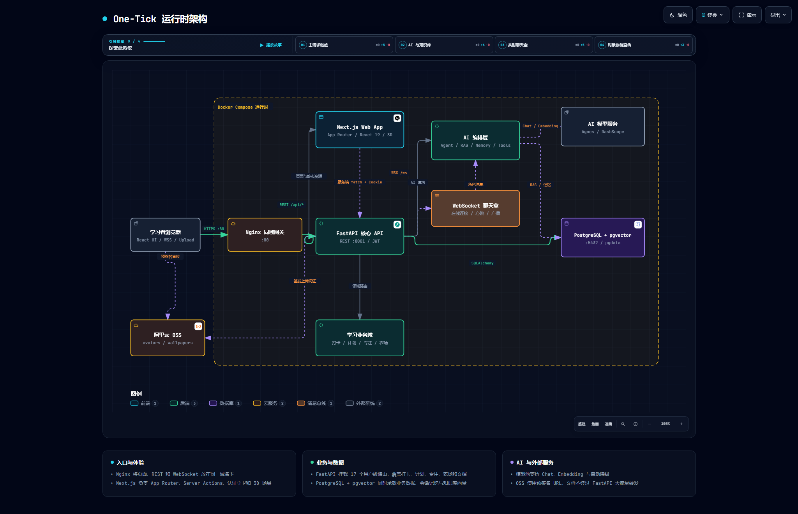

# One-Tick 一刻

> 把计划、任务、专注、打卡、植物反馈和 AI 助手串成一个可追溯的学习闭环。

One-Tick 是一个个人全栈项目，目标不是做功能页面集合，而是验证一套完整的学习产品链路：

```text
学习计划 → 任务拆解 → 专注记录 → 花园能量 → 浇水/收获 → 3D 小岛 → 统计复盘
```

同时，AI 不是独立聊天框，而是通过工具调用、RAG、长期记忆、Agent Run 和模型降级池接入真实业务数据。

## 当前状态

- 代码规模：28 张业务表，65 个 REST 路由，1 个 WebSocket 通道，15 个前端页面。
- 部署方式：Docker Compose（PostgreSQL + FastAPI + Next.js + Nginx）。
- 检索评测：`scripts/rag_eval/` 中有 9885 chunk 的检索评测记录。
- 公开仓库状态：整理中；功能与已知限制以本 README 和源码为准。
- 该项目用于作品集和面试交流，目前未授予开源许可证，转载或复用前请联系作者。

## 技术栈

| 层 | 技术 |
|---|---|
| 后端 | Python 3.12、FastAPI、SQLAlchemy 2.0、Alembic、Pydantic |
| 数据库 | PostgreSQL 16、pgvector、HNSW |
| AI | OpenAI-compatible SDK、多模型降级池、Tool Calling、RAG、Agent Runtime |
| 前端 | Next.js App Router、React 19、TypeScript、Tailwind CSS、Three.js / React Three Fiber |
| 实时 | WebSocket、心跳、限流、幂等去重 |
| 部署 | Docker Compose、Nginx、健康检查、容器启动自动迁移 |

## 系统结构

```text
用户浏览器
   │
   ▼
Nginx :80
   ├─ /api/*  /ws  → FastAPI :8001
   └─ /             → Next.js :3000
                              │
                              ▼
                 PostgreSQL 16 + pgvector
                 业务数据 + 会话 + 向量
```

后端按职责拆分：

```text
app/
├── routers/      HTTP / WebSocket 协议与鉴权入口
├── services/     统计、计划拆分、通知、用量、OSS、用户初始化
├── ai/
│   ├── model_pool.py   多 provider / 多模型降级与用量记账
│   ├── rag/            切块、embedding、pgvector 检索、精排
│   ├── agent/          AgentRun、计划生成、日报/周报
│   ├── memory.py       长期记忆提取、检索、去重、冷淘汰
│   └── tools/          study / rag / todo / agent 工具集合
├── models/       SQLAlchemy ORM
├── ws/           WebSocket 房间、协议和 AI 消息
└── main.py       FastAPI 入口
```

## 架构图



- 交互式架构图：[`architecture/one-tick.architecture.html`](architecture/one-tick.architecture.html)
- 架构源文件：[`architecture/one-tick.architecture.json`](architecture/one-tick.architecture.json)
- 维护交接：[`HANDOFF.md`](HANDOFF.md)

## AI 交互开发

### 1. `/api/ai` 对话链路

```text
POST /api/ai
  → 鉴权 + 每日 token 限额检查
  → 创建或读取 Conversation
  → 截断最近 20 轮上下文
  → 注入长期记忆和文档工作区上下文
  → 组装工具并运行受限 Agent Loop（最多 4 轮）
  → 模型池流式生成，token 增量实时返回
  → 保存消息、提取长期记忆、记录 token 用量
```

关键实现：

- 工具由 `create_*_tools(user_id)` 按用户创建，天然带用户隔离条件。
- `_run_agent_loop` 支持模型主动调用工具，再把结果回填给模型继续推理。
- LLM 调用放在独立线程，通过 `queue.Queue` 推送到 FastAPI `StreamingResponse`。
- 模型池按 HIGH / LOW / EMBEDDING 分档；429 进入 60 秒冷却，额度耗尽切换下一个模型。
- 对话完成后异步提取长期记忆，不阻塞主响应。

### 2. RAG 个人知识库

```text
上传 md / txt / pdf / docx
  → 文本提取
  → Markdown 按标题分块，普通文本按 500 字 + 50 overlap
  → batch embedding
  → DocumentChunk.embedding（1024 维）

提问
  → query embedding
  → pgvector Top-20 召回
  → 本地 cosine rerank Top-5
  → 注入带来源的参考资料
```

检索评测记录见 [`scripts/rag_eval/RAG_EVAL.md`](scripts/rag_eval/RAG_EVAL.md)。评测说明包含测试语料、指标定义、HNSW 参数扫描、端到端验证、失败口径和已知局限。

### 3. Agent Runtime

有两类职责不同的 Agent：

- **Planner Run**：生成计划草案，写入 `AgentApproval`，用户确认后才创建 `Plan` 和 `PlanTask`。
- **Daily Agent**：每日读取学习上下文，生成提醒、报告或建议，并将步骤和决策写入 `AgentRun` / `AgentDecision`。

`AgentRun`、`AgentStep`、`AgentApproval`、`AgentToolCall`、`AgentDecision` 让中间过程可查询、可解释，而不是只保存最终文本。

### 4. 长期记忆

- 类型：`goal` / `habit` / `preference` / `skill` / `weakness` / `fact`
- 字段：`importance`、`confidence`、`lastUsed`、可选 embedding
- 默认检索：重要性 + 时间衰减混合排序
- 提供 query 时：在最近 200 条带 embedding 的记忆中做 Python 余弦检索
- 冷记忆淘汰：低重要性、低置信度或长期未使用的记忆会被清理

> 注意：知识库检索已经使用 pgvector + HNSW；长期记忆的默认路径仍有一部分在 Python 层排序。两条链路的实现不同，文档中不要混为一谈。

## 规格驱动开发

仓库保留功能规格、技术计划和任务清单三个人工可读工件：

```text
specs/<feature>/
├── spec.md     需求和验收标准
├── plan.md     技术方案与边界
└── tasks.md    可执行任务和完成状态
```

设计决策记录放在 [`docs/adr/`](docs/adr/)。当行为发生变化时，要求同步更新对应 spec、实现和测试；spec 是协作契约，不替代源码和测试。

更多说明见 [`specs/README.md`](specs/README.md)。

## 快速开始

### Docker 全量启动

```bash
cp .env.example .env
# 填写 JWT_SECRET、数据库密码和至少一个模型 API Key
docker compose up -d --build
docker compose ps
```

访问 `http://localhost/`，健康检查为 `http://localhost/health`。

### 本地开发

后端：

```bash
python -m venv .venv
# Windows: .venv\Scripts\activate
# macOS/Linux: source .venv/bin/activate
pip install -r requirements.txt
docker compose up -d db
alembic upgrade head
uvicorn app.main:app --reload --port 8001
```

前端：

```bash
cd frontend
npm install
API_PROXY_TARGET=http://localhost:8001 npm run dev
```

前端生产构建：

```bash
cd frontend
npm run build
```

## 验证

```bash
# Python 语法检查
python -m compileall -q app

# 不依赖数据库的单元测试
python -m unittest discover -s tests -v
```

前端：

```bash
cd frontend
npm run typecheck
npm run lint
```

## 检索评测

评测脚本位于 `scripts/rag_eval/`：

- `ingest.py`：灌入评测语料
- `build_questions.py`：用固定 seed 生成评测问题
- `eval_rag.py`：对比旧路径、SQL Top-K 和 HNSW
- `sweep_ef.py`：扫描 `ef_search` 召回/延迟曲线
- `eval_e2e.py`：从 HTTP 链路验证端到端回答
- `teardown.py`：清理评测用户和数据

评测结论和限制见 [`scripts/rag_eval/RAG_EVAL.md`](scripts/rag_eval/RAG_EVAL.md)。

## 安全与配置

- 不要提交 `.env`、API Key、OSS 密钥、服务器密码或私钥。
- `.env.example` 只保留空占位和说明。
- 生产环境必须替换默认 `JWT_SECRET`，并配置 `CRON_SECRET`。
- 当前 Cookie 认证不是 HttpOnly，公开部署前应完成安全加固。
- 生产环境需要配置 HTTPS、备份、监控和日志轮转。

## 已知限制

- WebSocket 连接集合、模型池可用性状态都在单进程内存中，不能直接横向扩容。
- 长期记忆默认不是数据库级向量检索，规模变大后需要改为 pgvector。
- 签到和专注幂等主要靠应用层先查后写，强并发下应增加数据库唯一约束。
- RAG 生产路径当前取回整行 DocumentChunk，包括未被返回层使用的 embedding 字段。
- 评测集以单块可答问题为主，跨文档归纳类问题不足。
- 当前没有完整 CI/CD、统一异常监控和自动备份流程。
- 当前没有授予开源 License。