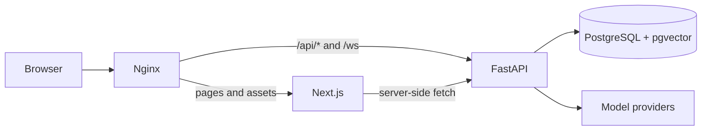
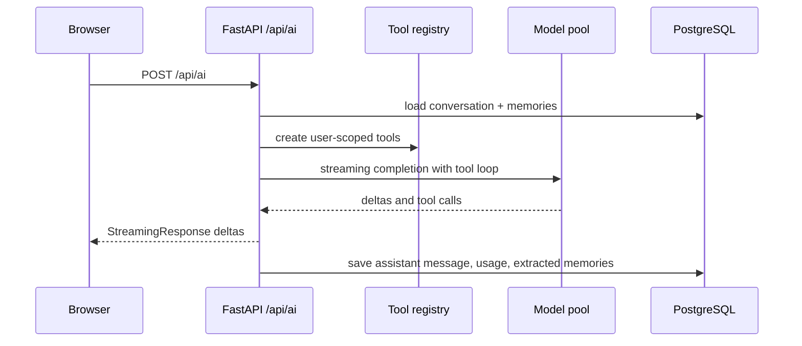

# Architecture

## Runtime topology

Nginx keeps the application on one origin. Browser requests use relative paths; the frontend uses the same session cookie without configuring a public API base URL.

## Backend layers

| Layer | Responsibility |
|---|---|
| `app/routers/` | Authentication, validation, HTTP and WebSocket protocol |
| `app/services/` | Reusable domain services: statistics, plan splitting, notifications, usage, OSS |
| `app/ai/` | Model routing, RAG, memory, Agent runtime, tool registry |
| `app/models/` | SQLAlchemy ORM and database constraints |
| `alembic/` | Schema evolution and pgvector index creation |
| `app/ws/` | Connection lifecycle, room broadcast, chat protocol, AI mentions |
| `frontend/src/` | App Router pages, Server Actions, UI, Three.js island |

## AI request path

## Data ownership

- Business queries are scoped by `userId`.
- `DocumentChunk` and `KnowledgeDoc` are per-user.
- AI tools created by `create_*_tools(user_id)` close over the current user ID.
- Planner approvals must belong to the current user before a write is performed.

## Important trade-offs

- pgvector keeps vectors in the same transaction and backup boundary as business data.
- HNSW is used because the knowledge base is written incrementally; `ef_search` is a measured trade-off.
- WebSocket is intentionally single-process at the current scale.
- Model-provider availability is process-local; it is business-level degradation, not platform-wide HA.