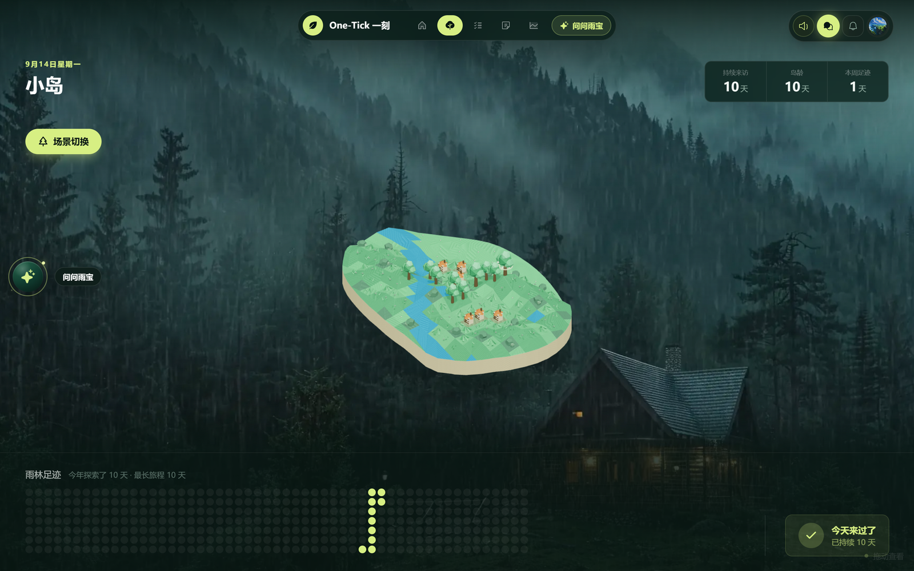
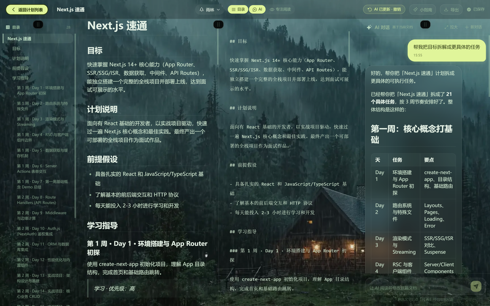
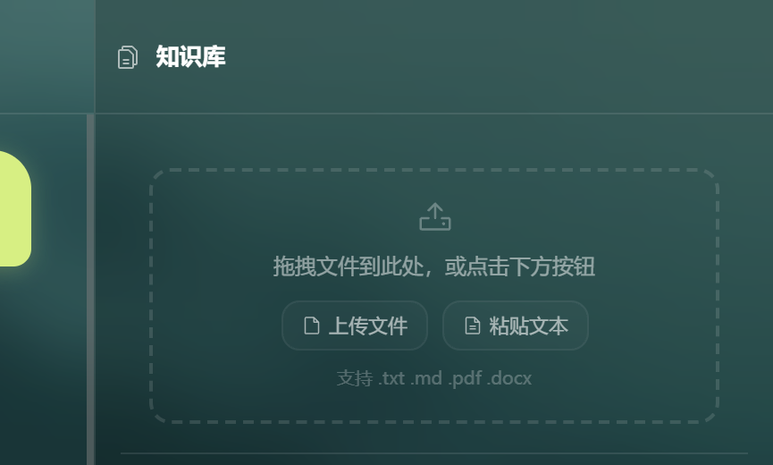

# One-Tick Product Case Study

## 产品目标

把“计划 → 执行 → 专注 → 反馈 → 复盘”集中在一个连续的学习闭环里，让用户看到的不只是打卡数字，而是长期积累形成的结果。

## 核心闭环

```text
学习计划
  → 任务拆解
  → 专注记录
  → 花园能量
  → 浇水与收获
  → 3D 小岛生长
  → 统计和复盘
```

## 产品设计

### 1. 专注不是直接兑换奖励

专注完成后先累积花园能量。用户需要主动浇水，植物会经历多个阶段；最高阶段后再浇一次才完成收获，并给小岛增加一棵树。

这样把一次专注的即时反馈和长期资产分开：单次努力马上有结果，小岛成长则需要连续行为。

### 2. 小岛根据真实数据生成

小岛的地形不是静态贴图。前端根据解锁地块数量计算海岸半径，对地块多边形做圆裁剪，再生成 `BufferGeometry`。收获次数决定可见树的数量。

### 3. AI 是业务助手，不是孤立聊天框

- 智能体读取打卡、计划、任务和记忆生成计划草案。
- 计划类写操作进入审批状态，用户确认后才写入。
- 知识库支持上传文档并基于检索结果回答。
- 聊天室 AI 具有独立角色协议。

## 界面

### 小岛与持续打卡



展示连续打卡、本周足迹、年度热力图和由收获次数驱动的小岛。

### AI 文档工作区



文档工作室支持在编辑计划的同时与 AI 对话，让 AI 基于当前文档给出可执行的拆解和修改建议。

### 知识库 RAG



知识库支持上传 `md`、`txt`、`pdf` 和 `docx`，检索后用于生成带来源的回答。

## 工程结果

- 28 张业务表、65 个 REST 路由、1 个 WebSocket 通道。
- 支持 RAG、长期记忆、工具调用、Agent 审批和多模型降级。
- 检索评测使用 9885 个 chunk，详细记录见 [`../../scripts/rag_eval/RAG_EVAL.md`](../../scripts/rag_eval/RAG_EVAL.md)。
- 公开部署地址和真实用户量不在仓库中宣称；对外说明以可复现的指标和代码为准。