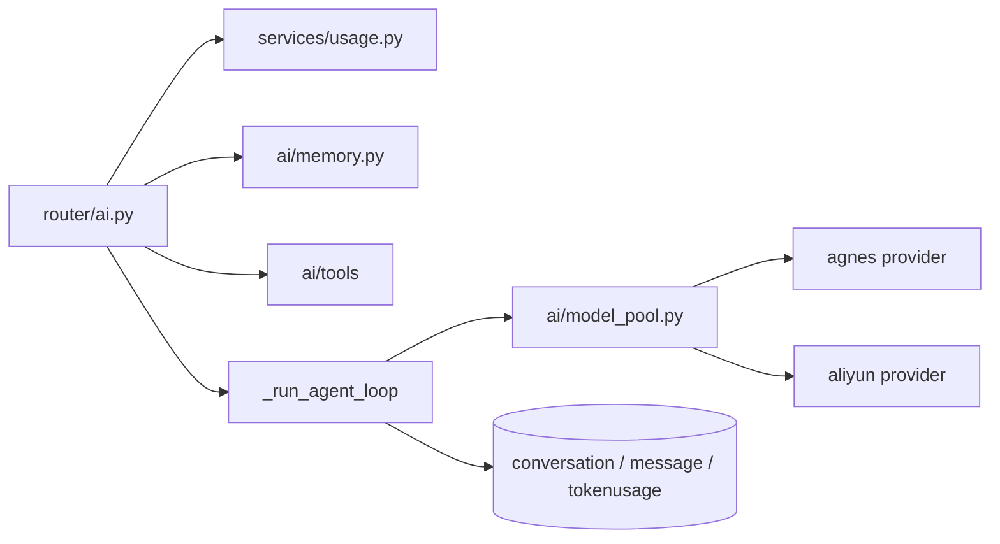

# Technical Plan: AI Chat Orchestration

| 字段 | 值 |
|---|---|
| Spec | `001-ai-chat-orchestration` |
| Status | implemented |
| Components | `routers/ai.py`、`ai/model_pool.py`、`ai/memory.py`、`ai/tools/*`、`services/usage.py`、`models/chat.py` |
| State | 模型池耗尽/冷却状态为进程内；会话与消息持久化在 PostgreSQL |
| Rollback | 回退应用镜像即可，无 schema 变更；已写入的会话与用量记录保留 |

## 1. 请求处理伪代码

```python
async def ai_chat(req: ChatRequest, user = Depends(get_current_user)):
    assert_interactive_usage_allowed(user.id)          # UsageLimitError → 友好提示
    conversation = resolve_or_create(req.conversationId, user.id)

    messages = req.messages
    if len(messages) > MAX_CONTEXT_MESSAGES:           # 40
        messages = messages[-MAX_CONTEXT_MESSAGES:]

    system = build_system_prompt(memories=load_memories(user.id))
    if req.deepThink:
        system += DEEP_THINK_INSTRUCTION
    if (doc := (req.studioContext or {}).get("document")):
        system += doc

    tools = {**create_study_tools(user.id),
             **create_todo_tools(user.id),
             **create_rag_tool(user.id)}
    specs = build_tool_specs(tools)                    # 只返回实际存在的工具

    def work():
        answer = run_agent_loop(system, messages, tools, specs, max_rounds=4)
        persist_in_own_session(conversation.id, user.id, answer)
        extract_memories(user.id, messages, answer)
    return StreamingResponse(stream_generator(work), headers={"X-Conversation-Id": conversation.id})
```

## 2. 组件交互



## 3. 鉴权与用户绑定

- `get_current_user` 先读 Cookie，再读 `Authorization: Bearer`。
- 返回的用户对象是后续所有查询的唯一 `userId` 来源；请求体里没有该字段。
- 任何失败路径（解码失败、用户不存在）统一 401。

## 4. 用量检查时机

检查发生在**模型调用之前**，因为额度耗尽的代价是一次失敗的上游请求加上用户等待。`AI_TOKEN_LIMIT=0` 表示不限量；embedding 调用不进入该检查。

## 5. 上下文与记忆

- 截断在服务端做，位置在消息组装之后、发送模型之前。
- 系统提示词显式声明「上下文窗口限制为最近 20 轮」，并要求模型在无法看到较早内容时请用户补充，而不是编造历史。
- 记忆注入按 `importance` 排序并限制条数，避免单请求上下文被记忆挤满。

## 6. 工具层

- 三类工具（study / todo / rag）在请求内创建，各自是 `user_id` 闭包。
- `build_tool_specs` 用工具名与注册表求交集，注册表里没有的规格不会下发给模型，避免模型调用不存在的工具。
- `_execute_tool_call` 对未知工具返回结构化失败，不抛异常。
- 工具内部统一走 `safe_execute`，异常被转成 `{"success": false, "error": ...}`。
- `_run_agent_loop(max_rounds=4)`：每轮模型决定是否调用工具；循环结束后必须有一次不带工具的结果作为最终文本。

## 7. 模型池

- 分档：HIGH（8）、LOW（5）、EMBEDDING（2）。
- 403 / `InsufficientBalance` → `mark_model_exhausted`，本进程不再使用该模型。
- 429 / rate limit → `mark_model_rate_limited(model, 60_000)`，到期自动恢复。
- OpenAI 客户端 `max_retries=0`：不把切流决策交给 SDK，避免 429 被内部重试拖长时间。
- 标记与查询由模块级 `threading.Lock` 保护。

## 8. 流式与落库

- `StreamingResponse` 逐增量下发；生成线程通过回调把 delta 推入队列。
- 落库在生成线程内、使用独立 `SessionLocal()`，不复用请求线程的 Session。
- 生成期间的数据库操作不持有请求级长事务。
- `X-Conversation-Id` 在响应头返回，前端据此把消息绑到正确会话。

## 9. 风险与缓解

| 风险 | 影响 | 缓解 |
|---|---|---|
| 模型额度集中耗尽 | AI 功能整体不可用 | 分档链条 + 跨供应商切换 |
| SDK 内部重试 | 429 被拖成十几秒等待 | `max_retries=0` |
| 上下文无限增长 | 成本与延迟失控 | 服务端强制截断 |
| 工具越权 | 读到他人数据 | 创建时绑定 `userId`，不接受模型传 ID |
| 工具异常冒泡 | 整次请求失败 | `safe_execute` 隔离 |
| 流式期间长事务 | 连接池耗尽 | 独立 Session，短事务 |
| 进程内状态 | 多实例行为不一致 | 已在规格中声明为已知边界 |

## 10. 验证

- 契约：`tests/test_ai_contract.py`（上下文常量、工具规格、计划草案上限）。
- 模型池：`scripts/test_model_pool.py`（403 永久耗尽 vs 429 冷却恢复）。
- 鉴权：`scripts/test_auth.py`。
- 对话：`scripts/test_chat.py`（流式、会话、落库）。
- 编译与单测：`python -m compileall -q app` + `python -m unittest discover -s tests -v`。

## 11. 回滚

无 schema 变更，回退镜像即可。已产生的会话、消息与用量记录向前兼容，不需要数据修复。
