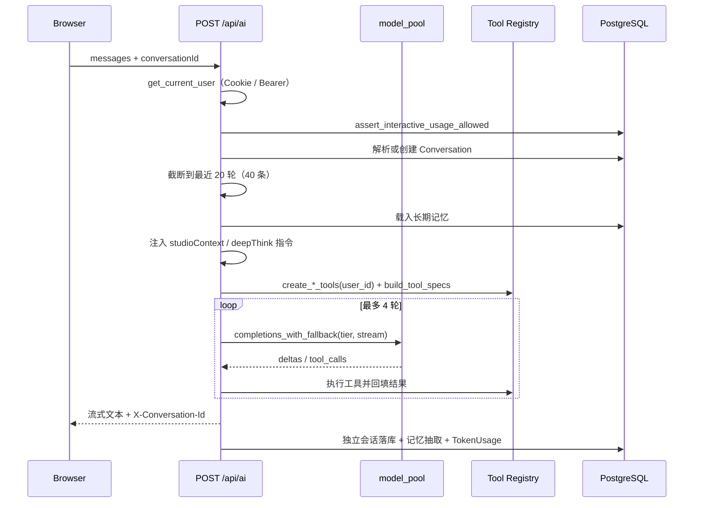

# Feature Specification: AI Chat Orchestration

| 字段 | 值 |
|---|---|
| Spec ID | `001-ai-chat-orchestration` |
| Status | implemented |
| Version | 2.0.0 |
| Owner | AI Service |
| Scope | `POST /api/ai`、`POST /api/ai/chat` 的鉴权、上下文、记忆、工具、模型降级与流式输出 |
| Related | `specs/002-rag-retrieval`、`specs/003-agent-runtime`、`specs/004-realtime-chat`、`specs/DEV_SPEC.md` §6.2 §10 |
| Evidence | `app/routers/ai.py`、`app/ai/model_pool.py`、`app/ai/memory.py`、`app/ai/tools/`、`app/services/usage.py`、`tests/test_ai_contract.py` |

## 1. 背景

一次对话请求同时要处理六件事：证明调用者是谁、确认还有额度、把历史压进上下文窗口、把用户的长期目标带进来、让模型能读写真实业务对象、在模型不可用时仍然给出回答。

如果把这些交给模型自由发挥，会产生四类问题：

1. 会话归属被请求体字段覆盖；
2. 上下文无限增长导致成本与延迟失控；
3. 工具越权读到别人的数据；
4. 模型额度耗尽后整个 AI 功能不可用。

AI Chat Orchestration 的职责是把这些约束固定成服务端流程，而不是留给 Prompt 去「自觉遵守」。

## 2. 目标

- 从 Cookie 或 Bearer 解析调用者身份，身份只来自鉴权结果。
- 在调用模型之前完成额度检查。
- 上下文窗口固定且可预测。
- 工具集合按用户创建，模型拿不到数据库凭据。
- 工具循环有界，且任何分支都必须产出最终文本。
- 模型不可用时自动切流，用户不感知供应商。
- 流式增量下发，落库与生成解耦。

## 3. 非目标

- 不实现多实例共享会话或模型状态。
- 不实现服务端会话记忆之外的用户画像建模。
- 不承诺模型输出的事实正确性（事实由工具与检索负责）。
- 不提供 hidden chain-of-thought。
- 不做计费结算，用量数据只用于限额与成本归因。

## 4. 角色与边界

| 角色 | 可以提供 | 不可以提供 |
|---|---|---|
| 浏览器前端 | Cookie、消息、`conversationId`、`deepThink`、`studioContext` | 用户 ID、额度、工具白名单 |
| 第三方客户端 | `Authorization: Bearer <token>`、消息 | 绕过用量检查 |
| AI Chat Service | 鉴权绑定、上下文、工具、模型选择、流式输出 | 跨用户数据读取 |
| 模型 Provider | 文本与工具调用候选 | 决定工具是否可执行 |
| 工具层 | 结构化业务结果 | 生成最终话术 |

## 5. 功能需求

### 5.1 鉴权与用量

| ID | 优先级 | 需求 | 验证 |
|---|---|---|---|
| R-AI-01 | P0 | 身份必须来自 Cookie 或 `Authorization: Bearer`，请求体不得覆盖 `userId`。 | 契约测试 + 401 用例 |
| R-AI-02 | P0 | 调用模型前执行当日 token 限额检查，超限抛 `UsageLimitError` 并返回友好提示而非 500。 | 超限用例 |
| R-AI-13 | P1 | 成功调用后按 `surface`/`user`/`tier`/`model` 记录 `TokenUsage`。 | 用量写入检查 |
| R-AI-14 | P2 | `AI_TOKEN_LIMIT=0` 时视为不限量。 | 配置用例 |

### 5.2 上下文与记忆

| ID | 优先级 | 需求 | 验证 |
|---|---|---|---|
| R-AI-03 | P0 | 上下文最多保留最近 20 轮（40 条消息），服务端必须二次兜底，不能只信前端。 | `test_ai_contract.py` |
| R-AI-04 | P0 | 注入长期记忆，但不得突破用户边界；记忆条数受限。 | 越权用例 |
| R-AI-09 | P1 | `studioContext.document` 存在时把文档正文注入上下文。 | 契约常量 |
| R-AI-10 | P1 | `deepThink=true` 时注入「先梳理再作答」的系统指令。 | 契约常量 |
| R-AI-11 | P2 | 新会话由 LOW 档生成标题，失败时回落首条消息前 20 字。 | 回落用例 |

### 5.3 工具

| ID | 优先级 | 需求 | 验证 |
|---|---|---|---|
| R-AI-05 | P0 | 工具循环最多 4 轮，且无论是否触发工具都必须产出最终文本。 | Agent Loop 契约 |
| R-AI-12 | P0 | 工具在创建时绑定 `userId`；未知工具返回 `{"success": false}`；工具异常不得中断整次请求。 | 工具契约 |
| R-AI-15 | P0 | 工具描述与 JSON Schema 只暴露能力与参数，不暴露数据库结构或凭据。 | Schema 检查 |
| R-AI-16 | P1 | 只注册当前确实存在的工具，缺失的工具不出现在 `tools` 参数里。 | 注册表检查 |

### 5.4 模型与输出

| ID | 优先级 | 需求 | 验证 |
|---|---|---|---|
| R-AI-06 | P0 | 模型池按 HIGH / LOW / EMBEDDING 分档；403 永久耗尽，429 冷却 60 秒后恢复。 | `scripts/test_model_pool.py` |
| R-AI-07 | P0 | 响应为 `text/plain` 流式增量；落库使用独立数据库会话。 | 流式用例 |
| R-AI-08 | P0 | 响应头返回 `X-Conversation-Id`。 | 响应头断言 |
| R-AI-17 | P1 | 未指定 `conversationId` 时新建会话并返回其 ID；指定了不存在的 ID 返回 404。 | 会话用例 |

## 6. 输入契约

```python
class ChatRequest(BaseModel):
    messages: list[Message]            # 必填，至少一条
    conversationId: str | None = None  # 为空则新建会话
    deepThink: bool = False            # 深度思考开关
    studioContext: dict | None = None  # 文档工作室上下文（document 字段）

class Message(BaseModel):
    role: Literal["user", "assistant", "system"]
    content: str
```

校验规则：

1. `messages` 为空或缺失 → 400 `Messages are required`。
2. `conversationId` 非空但会话不存在或不属于当前用户 → 404 `会话不存在`。
3. 超长历史**不报错**，由服务端截断到最近 40 条并打印截断日志。

## 7. 输出契约

- 响应体：`text/plain`，按增量分片下发，前端逐片追加渲染。
- 响应头：`X-Conversation-Id: <conversationId>`。
- 持久化：`Conversation` + `ConversationMessage`，AI 回复额外写 `AIHistory`。
- 失败：用量超限返回可读提示文本（不是 500）。

## 8. 处理时序



## 9. 失败行为

| 场景 | 行为 |
|---|---|
| 未鉴权 | 401 |
| `messages` 为空 | 400 `Messages are required` |
| 会话不存在 / 不属于当前用户 | 404 `会话不存在` |
| 当日额度耗尽 | 返回友好提示文本，不抛 500 |
| 单个模型 403 | 标记该模型本进程耗尽，切下一个；调用方无感 |
| 单个模型 429 | 该模型冷却 60 秒，切下一个 |
| 整档模型都不可用 | 记录日志；由上层决定是否返回降级文案 |
| 单个工具抛异常 | `safe_execute` 捕获并返回 `success: false`，循环继续 |
| 工具循环到上限仍未产出文本 | 强制最后一轮不带工具调用，产出最终文本 |
| 流式过程中连接中断 | 落库逻辑在独立会话中完成，不受客户端断开影响 |

## 10. 可观测性

- 服务端输出：截断事件（`[AI] 后端截断: N → 40 条消息`）、模型切换（`[model-pool] <model> 免费额度耗尽，降级`）、工具调用（`[AgentLoop] 调用工具 <name>`）。
- 数据侧：`TokenUsage` 可按用户、surface、tier、model 聚合。
- 不记录：系统 Prompt 全文、用户完整隐私内容之外的任何隐藏推理。

## 11. 验收标准

| AC | 内容 | 方式 |
|---|---|---|
| AC1 | 上下文契约常量为 20 轮 / 40 条，且服务端存在二次截断 | `python -m unittest tests.test_ai_contract -v` |
| AC2 | 未鉴权请求返回 401 | `scripts/test_auth.py` |
| AC3 | 模型池在 403 与 429 下产生不同的标记与不同的恢复行为 | `scripts/test_model_pool.py` |
| AC4 | 工具循环最多 4 轮并产出最终文本 | 代码审查 + 手工冒烟 |
| AC5 | 流式响应带 `X-Conversation-Id`，消息落库成功 | `scripts/test_chat.py` |
| AC6 | 额度耗尽返回友好提示而不是 5xx | 手工冒烟（重设 `AI_TOKEN_LIMIT=1`） |

## 12. 需求追踪

| 需求 | 计划 | 任务 | 验证 |
|---|---|---|---|
| R-AI-01 | Plan §3 | T-AI-01 | 契约测试 + 401 用例 |
| R-AI-02 | Plan §4 | T-AI-02 | 超限用例 |
| R-AI-03 | Plan §5 | T-AI-03 | `test_ai_contract.py` |
| R-AI-04 | Plan §5 | T-AI-04 | 越权用例 |
| R-AI-05 | Plan §6 | T-AI-05 | Agent Loop 契约 |
| R-AI-06 | Plan §7 | T-AI-06 | `test_model_pool.py` |
| R-AI-07 | Plan §8 | T-AI-07 | 流式用例 |
| R-AI-08 | Plan §8 | T-AI-08 | 响应头断言 |
| R-AI-12 | Plan §6 | T-AI-09 | 工具契约 |
| R-AI-17 | Plan §5 | T-AI-10 | 会话用例 |
