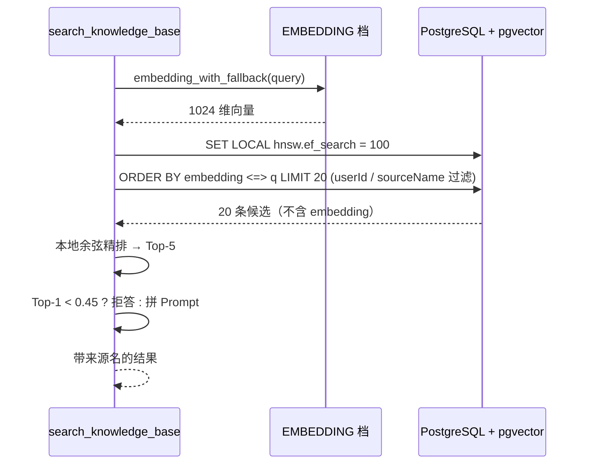

# Feature Specification: RAG Retrieval

| 字段 | 值 |
|---|---|
| Spec ID | `002-rag-retrieval` |
| Status | implemented |
| Version | 2.0.0 |
| Owner | AI Service |
| Scope | 文档摄取、分块、向量化、pgvector 检索、精排、拒答与引用 |
| Related | `specs/001-ai-chat-orchestration`、`specs/DEV_SPEC.md` §7.3 §8 |
| Evidence | `app/routers/knowledge.py`、`app/routers/documents.py`、`app/ai/rag/*`、`app/models/knowledge.py`、`alembic/versions/0004_rag_vector_index.py`、`scripts/rag_eval/`、`tests/test_chunking.py` |

## 1. 背景

知识库要回答的问题是「用户自己的资料里到底写了什么」。系统有两种失败方式：

1. **答不上来**：检索根本没命中正确内容，模型只能用通用知识补，用户以为资料里有答案。
2. **编答案**：检索没有相关内容，模型仍然按上下文硬编一个答案。

这两种失败的责任在检索层，不在 Prompt。因此检索链路必须有可量化的召回能力，也必须有明确的拒答边界。

此外，当前实现替换掉了一个真实缺陷：旧检索用 `LIMIT 1000` 先把候选集限死在最新录入的 1000 块，语料超过 1000 块后更早的内容**永远进不了候选集**。这在 9885 块语料上表现成 Hit@5 只有 7.5%，是召回缺口，不是排序质量问题。

## 2. 目标

- 上传的文档能被解析、分块、向量化并落库，且明确归属用户。
- 检索在数据库侧完成 Top-K，不把向量搬回应用层。
- 精排可替换、可回退，且失败不阻断回答。
- 没有相关内容时明确拒答，并区分「知识库没有」与「通用知识补充」。
- 检索参数有实测依据，指标口径可复现。
- 来源名一路保留到 Prompt，回答能给出引用。

## 3. 非目标

- 不实现跨用户共享知识库。
- 不实现 OCR、图片内容理解与多模态问答。
- 不实现 Query Rewrite、HyDE、多跳检索。
- 不提供独立向量数据库。
- 不承诺对超长文档的完整语义覆盖（分块必然丢上下文）。

## 4. 角色与边界

| 角色 | 可以做 | 不可以做 |
|---|---|---|
| 浏览器 | 上传/删除自己的文档、发起检索 | 检索他人文档 |
| 摄取链路 | 解析、分块、向量化、写 `DocumentChunk` | 修改业务学习数据 |
| 检索链路 | 只读查询向量与文本 | 写入任何业务状态 |
| 精排层 | 重排候选、判定拒答 | 改变召回集合 |
| 对话层 | 消费检索结果并生成回答 | 越过阈值强行作答 |

## 5. 功能需求

### 5.1 摄取

| ID | 优先级 | 需求 | 验证 |
|---|---|---|---|
| R-RAG-01 | P0 | 上传文档必须携带 `userId`，落库的 `DocumentChunk` 必须带归属用户。 | 越权用例 |
| R-RAG-02 | P0 | 分块按「先分段、再限长、句末回退」执行；长段落切分必须在标点处优先断开。 | `tests/test_chunking.py` |
| R-RAG-03 | P0 | 切分到文本末尾时必须显式终止，不能退化成「每次前进 1 个字符」的重复分片。 | `tests/test_chunking.py` |
| R-RAG-04 | P1 | Markdown 按 `##` 语义分片；超长段落内部再切分且保留标题行。 | `tests/test_chunking.py` |
| R-RAG-05 | P0 | 向量化走模型池 EMBEDDING 档，失败时自动切换备用 embedding 模型。 | 模型池验证 |
| R-RAG-06 | P1 | 同一用户同一 `sourceName` 在 `KnowledgeDoc` 上唯一。 | schema 约束 |
| R-RAG-07 | P0 | 删除文档或用户时，其文档块与向量必须被一并清理。 | CASCADE 用例 |

### 5.2 检索

| ID | 优先级 | 需求 | 验证 |
|---|---|---|---|
| R-RAG-08 | P0 | 检索必须把 Top-K 计算下推到数据库，使用余弦距离算子 `<=>` 排序。 | 代码审查 + 评测 |
| R-RAG-09 | P0 | 每次检索事务内设置 `SET LOCAL hnsw.ef_search = 100`，不得使用会话级 `SET`。 | SQL 检查 |
| R-RAG-10 | P0 | 可选过滤：`userId`、`sourceName`；并始终排除 `embedding IS NULL` 的记录。 | 检索用例 |
| R-RAG-11 | P0 | 返回值 `DocChunk` 不包含 embedding 字段。 | 契约检查 |
| R-RAG-12 | P0 | 召回阶段取 Top-20，精排后取 Top-5 进入上下文。 | 契约常量 |

### 5.3 精排、拒答与引用

| ID | 优先级 | 需求 | 验证 |
|---|---|---|---|
| R-RAG-13 | P0 | 精排失败时回退纯向量排序，并把 `score` 置 0 标记「无重排分数」，不得抛错阻断回答。 | 回退用例 |
| R-RAG-14 | P0 | Top-1 相似度低于 0.45 时拒答，并明确区分「知识库未找到」与「按通用知识补充」。 | 端到端评测 |
| R-RAG-15 | P1 | 拼入 Prompt 时保留来源名，格式为 `[参考N]（来源: xxx）`。 | Prompt 格式检查 |
| R-RAG-16 | P1 | 工具 `searchKnowledgeBase` 在无结果时返回 `found: false` 与可读说明，而不是空数组。 | 工具契约 |

### 5.4 质量

| ID | 优先级 | 需求 | 验证 |
|---|---|---|---|
| R-RAG-17 | P0 | 检索行为变更必须更新 `scripts/rag_eval/RAG_EVAL.md` 的证据，口径包含语料规模、问题数、索引参数。 | 文档评审 |
| R-RAG-18 | P0 | 生产配置在 9885 块语料上 Hit@5 不低于 0.85。 | `eval_rag.py` |
| R-RAG-19 | P1 | 10 条无答案问题必须全部如实说明「知识库没有」，不得编造。 | `eval_e2e.py` |

## 6. 对外契约

```python
@dataclass
class DocChunk:
    id: str
    sourceName: str
    sourceType: str
    chunkIndex: int
    content: str
    createdAt: datetime          # 不含 embedding

def search_similar_chunks(
    query_embedding: list[float],
    top_k: int = 5,
    source_filter: str | None = None,
    user_id: str | None = None,
) -> list[DocChunk]: ...

def search_knowledge(query, user_id, final_top_n=5) -> dict:
    # {"query": str, "results": [{"content","sourceName","score","chunkIndex"}], "searchedChunks": int}
    ...
```

分块契约：

```python
split_text(text, chunk_size=500, overlap=50) -> list[str]
split_markdown(text, max_chunk_size=800)     -> list[str]
```

## 7. 数据契约

```text
DocumentChunk
  id (uuid hex), userId → user.id ON DELETE CASCADE
  sourceName, sourceType, chunkIndex, content
  embedding  Vector(1024)                 # pgvector
  createdAt
  Index: (userId, sourceName), (sourceName)
  Index: HNSW(embedding vector_cosine_ops) WITH (m=16, ef_construction=64)

KnowledgeDoc
  id, userId → user.id ON DELETE CASCADE
  sourceName, sourceType, content, createdAt
  Unique: (userId, sourceName)
```

## 8. 检索时序



## 9. 失败行为

| 场景 | 行为 |
|---|---|
| 上传格式不支持 | 返回明确错误，不落库 |
| embedding 档模型 403 | 标记耗尽，切下一个 embedding 模型 |
| embedding 档全部不可用 | 抛错并记日志，摄取失败可重试 |
| 检索无命中 | 返回空结果，由工具转成 `found: false` |
| 精排异常 | 回退纯向量排序，`score` 置 0，回答继续 |
| Top-1 低于阈值 | 走拒答话术，区分「知识库没有」与「通用知识补充」 |
| 跨用户检索 | 由 `userId` 过滤在 SQL 层阻断 |
| HNSW 索引缺失 | 退化为顺序扫描，结果正确但延迟上升；回滚时必须复查 `pg_indexes` |

## 10. 可观测性

- 分块日志：`[Chunk] <输入字数> 字 → <分片数> 个分片 (size=, overlap=)`。
- 检索日志：`[Retriever] 近邻搜索 → N 条 (k=, ef_search=100)`。
- 工具日志：搜索用户、命中条数、扫描文档块数。
- 评测产物：`scripts/rag_eval/metrics_*.json`、`questions.jsonl`、`RAG_EVAL.md`。

## 11. 验收标准

| AC | 内容 | 方式 |
|---|---|---|
| AC1 | 四种分块边界（空文本、短段落、Markdown 标题随段落、超长段落切分）全部通过 | `python -m unittest tests.test_chunking -v` |
| AC2 | 检索返回对象不含 embedding | 代码审查 + 契约检查 |
| AC3 | 生产配置 Hit@5 ≥ 0.90、Recall@20 ≥ 0.925，P50 在毫秒级 | `python scripts/rag_eval/eval_rag.py` |
| AC4 | `ef_search` 扫描曲线单调，平台区为 100–200 | `python scripts/rag_eval/sweep_ef.py` |
| AC5 | 10 条无答案问题全部如实说明知识库无内容 | `python scripts/rag_eval/eval_e2e.py` |
| AC6 | 评测前后不污染真实用户数据 | `python scripts/rag_eval/teardown.py` 后检查评测用户已被删除 |

## 12. 需求追踪

| 需求 | 计划 | 任务 | 验证 |
|---|---|---|---|
| R-RAG-01 | Plan §3 | T-RAG-01 | 越权用例 |
| R-RAG-02 | Plan §4 | T-RAG-02 | `test_chunking.py` |
| R-RAG-03 | Plan §4 | T-RAG-03 | `test_chunking.py` |
| R-RAG-05 | Plan §5 | T-RAG-04 | 模型池验证 |
| R-RAG-07 | Plan §3 | T-RAG-05 | CASCADE 用例 |
| R-RAG-08 | Plan §6 | T-RAG-06 | 评测 |
| R-RAG-09 | Plan §6 | T-RAG-07 | SQL 检查 |
| R-RAG-11 | Plan §6 | T-RAG-08 | 契约检查 |
| R-RAG-12 | Plan §7 | T-RAG-09 | 契约常量 |
| R-RAG-13 | Plan §7 | T-RAG-10 | 回退用例 |
| R-RAG-14 | Plan §7 | T-RAG-11 | 端到端评测 |
| R-RAG-16 | Plan §8 | T-RAG-12 | 工具契约 |
| R-RAG-17 | Plan §9 | T-RAG-13 | 文档评审 |
| R-RAG-18 | Plan §9 | T-RAG-14 | `eval_rag.py` |
| R-RAG-19 | Plan §9 | T-RAG-15 | `eval_e2e.py` |
