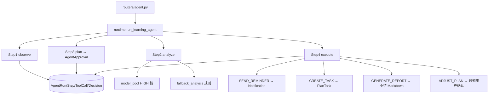

# Technical Plan: Agent Runtime and Approval

| 字段 | 值 |
|---|---|
| Spec | `003-agent-runtime` |
| Status | implemented |
| Components | `ai/agent/{runtime,service,types,decisions,report,weekly}.py`、`ai/tools/agent_tools.py`、`routers/agent.py`、`models/agent.py` |
| State | 运行、步骤、审批、决策、工具调用全部持久化；无进程内运行队列 |
| Rollback | 回退应用镜像；保留的 `AgentRun` 记录向前兼容，不需数据修复 |

## 1. 运行伪代码

```python
def run_learning_agent(user_id, persist=True):
    run = AgentRun(userId=user_id, mode="planner", status="running", goal=...)

    step1 = new_step(run, 1, "observe")
    context = observe(user_id)                     # 纯读，不写业务
    complete(step1, output=context)

    step2 = new_step(run, 2, "analyze")
    analysis = analyze(context, memories, user_id) # HIGH 档，失败走 fallback_analysis
    complete(step2, output=analysis)

    step3 = new_step(run, 3, "plan")
    approvals = persist_approvals(run, analysis["actions"])
    complete(step3, output={"findings": len(...), "actions": len(...)})

    step4 = new_step(run, 4, "execute")
    decisions = execute_actions(user_id, analysis["actions"])
    complete(step4, output={"executed": len(decisions)})

    run.status = "completed"; run.summary = summarize(analysis)
```

## 2. 组件交互



## 3. 状态与落表

| 状态 | Owner | 生命周期 |
|---|---|---|
| `AgentRun` | 本次运行 | 创建到终态 |
| `AgentStep` | 单个步骤 | 步骤开始到完成/失败 |
| `AgentApproval` | 待确认动作 | 触发到用户决策 |
| `AgentDecision` | 单条 action 结果 | 执行时写入 |
| `AgentToolCall` | 单次工具调用 | 调用时写入 |

`AgentRun` 与子表用 `cascade="all, delete-orphan"`；`AgentStep` 用 `(runId, stepNumber)` 唯一约束保证顺序；索引 `(userId, updatedAt)`、`(userId, status)`、`(runId, status)` 服务前端查询。

## 4. Observe 的查询集合

`observe(user_id)` 只读，不产生副作用：

- 打卡记录与连续天数；
- 活跃计划（`status='active'`）及其任务统计（total / done / inProgress / pending / skipped）与进度百分比；
- 待办（`pending` / `in_progress`，按 `priority desc, dayNumber asc`）；
- 今日专注记录与分钟数；
- 与目标相关的长期记忆（`importance` 排序）。

## 5. Analyze 与降级

- 提示词要求模型输出 `{status, findings[], actions[]}` 的 JSON。
- 使用 HIGH 档：`completions_with_fallback("high", ..., max_tokens=16384)`。
- 解析失败重试一次。
- 重试仍失败或模型池不可用 → `fallback_analysis(context)`：按规则阈值生成保底 findings 与 actions（例如：无活跃计划 → 建议建立计划；计划进度 < 30% 且任务数 > 5 → 建议调整拆解）。这条路径保证 Agent 的可用性不依赖模型可用性。

## 6. Execute 与副作用控制

| action | 副作用 | 约束 |
|---|---|---|
| `SEND_REMINDER` | 创建 `Notification` | 同类型当日只发一条（先查后写） |
| `CREATE_TASK` | 创建 `PlanTask` | 必须落到当前用户的首个活跃计划 |
| `GENERATE_REPORT` | 生成小结 Markdown 并落 `Notification` | 只读聚合，不改业务状态 |
| `ADJUST_PLAN` | 发通知引导用户到 `/agent` 确认 | 不自动改计划结构 |
| `ENCOURAGE` | 生成鼓励文案 | 无副作用 |

原则：**自动执行的都是可逆或低风险动作；会改变用户计划结构的动作只发通知，等用户确认**。所有执行结果写 `AgentDecision`，状态为 `pending` 的动作等待用户决策。

## 7. 输出校验

`types.py` 用 Pydantic 把模型输出约束成 `PlanDraft` / `TaskDraft`：

- `tasks` 最多 40 条；
- `title` 1–160、`description` ≤ 600；
- `dayNumber` 1–365、`weekNumber` 1–52；
- `category` / `priority` 固定枚举；
- `assumptions` 最多 8 条。

校验失败即视为模型输出不可用，进入重试或兜底路径，不把脏数据写进业务表。

## 8. 入口与定时

`/api/agent/cron/daily` 需要 `Authorization: Bearer <CRON_SECRET>`；`CRON_SECRET` 为空时视为本地调试模式放行。定时巡检和手动触发走同一套 `run_learning_agent`，行为一致。

## 9. 风险与缓解

| 风险 | 影响 | 缓解 |
|---|---|---|
| 模型输出结构漂移 | 脏数据入业务表 | Pydantic 校验 + 重试 + 兜底 |
| 模型整体不可用 | Agent 无产出 | `fallback_analysis` 规则路径 |
| 自动写入破坏用户计划 | 用户数据被改坏 | 结构性变更只发通知待确认 |
| 步骤顺序错乱 | 时间轴无法还原 | `(runId, stepNumber)` 唯一约束 |
| 越权读写 | 跨用户数据泄漏 | 用户域工具闭包 + 归属校验 |
| 通知刷屏 | 用户体验受损 | 同类当日节流 |
| 运行状态进程内 | 无断点续跑 | 已声明为已知边界 |

## 10. 验证

- `tests/test_ai_contract.py`：`PlanDraft` 上限与 AI 契约常量。
- `scripts/test_agent.py`：Agent 端到端冒烟。
- 手工：清空模型 Key 后触发运行，确认兜底路径仍产出 findings / actions。
- SQL 检查：确认 `AgentStep` 的 `(runId, stepNumber)` 无重复、删除运行后子表级联清空。

## 11. 回滚

回退应用镜像即可。已产生的运行记录保持可读，`AgentRunResponse` 契约向后兼容。
