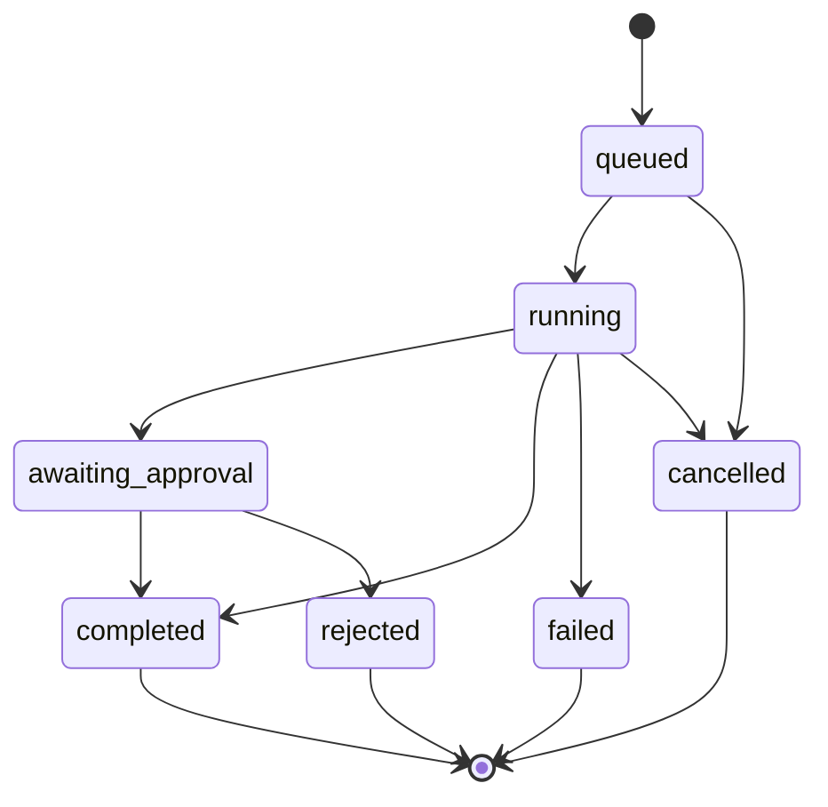

# Feature Specification: Agent Runtime and Approval

| 字段 | 值 |
|---|---|
| Spec ID | `003-agent-runtime` |
| Status | implemented |
| Version | 2.0.0 |
| Owner | AI Service |
| Scope | Agent 运行状态机、四步执行、工具调用、审批与决策留痕、计划草案校验 |
| Related | `specs/001-ai-chat-orchestration`、`specs/002-rag-retrieval`、`specs/DEV_SPEC.md` §6.3 §9 |
| Evidence | `app/ai/agent/*`、`app/routers/agent.py`、`app/ai/tools/agent_tools.py`、`app/models/agent.py`、`tests/test_ai_contract.py` |

## 1. 背景

Agent 要做的是「看数据 → 形成判断 → 提出动作 → 执行动作」。如果把这段交给模型自由发挥，会出现四个问题：

1. 运行过程不可解释：只看到一句总结，不知道模型看了什么、为什么这么建议。
2. 失败不可定位：运行报错后无法知道坏在哪一步。
3. 自动写入不可控：模型可以直接创建任务、发通知，用户没有确认机会。
4. 输出不可校验：模型返回的 JSON 结构可能缺字段或超出范围。

Agent Runtime 的职责是把这四件事变成可持久化、可校验、可回溯的系统状态。

## 2. 目标

- 每次运行有唯一 `run_id`，状态可枚举、可查询。
- 四步（Observe / Analyze+Plan / Plan / Execute）逐步落表，任一步失败可定位。
- 模型输出经过 Pydantic 校验，超限即拒绝。
- 会产生副作用的动作进入审批记录，决策结果留痕。
- 模型整体不可用时仍有规则兜底产出。
- 所有工具在用户域内创建，改写类工具必须校验对象归属。

## 3. 非目标

- 不实现多实例共享运行状态与断点续跑。
- 不实现 Agent 自主规划任意工具（工具集合固定）。
- 不实现真实的外部副作用（不对外发消息、不写第三方系统）。
- 不提供 hidden chain-of-thought；只记录输入输出与结论。
- 不做长周期任务调度（每日巡检只做一次聚合分析）。

## 4. 角色与边界

| 角色 | 可以做 | 不可以做 |
|---|---|---|
| 用户 | 触发运行、查看时间轴、确认或拒绝审批项、取消运行 | 修改已完成步骤的记录 |
| Agent Runtime | 收集上下文、调用模型、落表、执行动作 | 越过工具白名单、跨用户读写 |
| 审批层 | 记录待确认动作与决策理由 | 修改冻结的上下文快照 |
| 工具层 | 在 `userId` 闭包内读写业务对象 | 信任模型传入的用户标识 |
| 模型 | 输出结构化 JSON（status / findings / actions） | 直接写数据库 |

## 5. 功能需求

### 5.1 运行与状态

| ID | 优先级 | 需求 | 验证 |
|---|---|---|---|
| R-AGENT-01 | P0 | 每次运行创建 `AgentRun`，状态属于固定枚举（7 种）。 | 状态枚举测试 |
| R-AGENT-02 | P0 | 每个步骤写 `AgentStep`，`(runId, stepNumber)` 唯一，`status ∈ {running, completed, failed}`。 | 唯一约束 + 契约测试 |
| R-AGENT-03 | P0 | 任一步抛异常时，当前 Step 记 `failed` + `error`，`AgentRun.status=failed`，已完成步骤保留。 | 失败用例 |
| R-AGENT-04 | P0 | `currentStep` 与 `maxSteps`（默认 12）可查询，前端据此渲染进度。 | 响应契约 |
| R-AGENT-05 | P1 | `summary` 为一句自然语言，运行完成后写入，失败时为 `null`。 | 响应契约 |

### 5.2 四步执行

| ID | 优先级 | 需求 | 验证 |
|---|---|---|---|
| R-AGENT-06 | P0 | Step1 Observe 收集：打卡记录与连续天数、活跃计划与任务统计、待办、今日专注分钟、相关长期记忆。 | Observe 输出检查 |
| R-AGENT-07 | P0 | Step2 Analyze 使用 HIGH 档模型，输出 JSON 含 `status` / `findings` / `actions`。 | 契约测试 |
| R-AGENT-08 | P0 | `status` 必须属于 `on_track` / `need_attention` / `need_adjustment` / `at_risk`。 | 枚举校验 |
| R-AGENT-09 | P0 | `action.type` 必须属于 `ADJUST_PLAN` / `CREATE_TASK` / `SEND_REMINDER` / `GENERATE_REPORT` / `ENCOURAGE`。 | 枚举校验 |
| R-AGENT-10 | P0 | Step4 逐条执行 action，任一条失败不影响其余 action。 | 部分失败用例 |
| R-AGENT-11 | P0 | `SEND_REMINDER` 同类通知当日只发一条。 | 节流用例 |

### 5.3 模型输出校验

| ID | 优先级 | 需求 | 验证 |
|---|---|---|---|
| R-AGENT-12 | P0 | `PlanDraft.tasks` 最多 40 条，超出即校验失败。 | `tests/test_ai_contract.py` |
| R-AGENT-13 | P0 | `TaskDraft.title` 长度 1–160，`description` ≤ 600。 | 契约测试 |
| R-AGENT-14 | P0 | `dayNumber` 范围 1–365，`weekNumber` 范围 1–52，越界即拒绝。 | 契约测试 |
| R-AGENT-15 | P1 | `category ∈ {study, project, review, exercise}`，`priority ∈ {high, normal, low}`。 | 枚举校验 |
| R-AGENT-16 | P1 | `PlanDraft.assumptions` 最多 8 条。 | 契约测试 |
| R-AGENT-17 | P0 | 模型 JSON 解析失败重试一次；仍失败或模型不可用时走 `fallback_analysis` 规则兜底。 | 兜底用例 |

### 5.4 审批、决策与权限

| ID | 优先级 | 需求 | 验证 |
|---|---|---|---|
| R-AGENT-18 | P0 | 产生副作用的动作写入 `AgentApproval`，状态默认 `pending`。 | 落表检查 |
| R-AGENT-19 | P0 | 每条 action 的执行结果写 `AgentDecision`，含状态与原因。 | 落表检查 |
| R-AGENT-20 | P0 | 读取运行、审批、取消运行都必须校验运行归属当前用户。 | 越权用例 |
| R-AGENT-21 | P0 | 改写类工具（`updateTodo` / `deleteTodo` / `updateTaskStatus` / `breakdownPlanTasks` / `getPlanTasks`）必须校验对象归属。 | 越权用例 |
| R-AGENT-22 | P1 | 定时入口 `/api/agent/cron/daily` 需 Bearer `CRON_SECRET`；未配置时视为本地调试放行。 | 入口用例 |

## 6. 数据契约

```text
AgentRun.status ∈ { queued, running, awaiting_approval, completed, failed, cancelled, rejected }

AgentStep
  (runId, stepNumber) UNIQUE
  kind   ∈ { observe, analyze, plan, execute }
  status ∈ { running, completed, failed }
  input / output : JSON

PlanDraft
  name        : 1..120
  description : ≤ 600
  goal        : 1..600
  tasks       : ≤ 40 × TaskDraft
  assumptions : ≤ 8

TaskDraft
  title       : 1..160
  description : ≤ 600
  dayNumber   : 1..365
  weekNumber  : 1..52
  category    : study | project | review | exercise
  priority    : high | normal | low
```

响应契约（`AgentRunResponse`）包含 `id / mode / goal / status / currentStep / maxSteps / summary / error / startedAt / completedAt / createdAt / updatedAt / steps[] / approvals[]`，其中 `steps[]` 带 `stepNumber / kind / status / title / detail / input / output / error / startedAt / completedAt`。

## 7. 状态机



## 8. 工具注册表

| 工具 | 类型 | 归属校验 |
|---|---|---|
| `getStudyStats` | 只读 | — |
| `getMyPlans` | 只读 | — |
| `getRecentCheckins` | 只读 | — |
| `getMyMemories` | 只读 | — |
| `createPlan` | 写入 | 用户域 |
| `getMyTodos` | 只读 | — |
| `createTodo` | 写入 | 用户域 |
| `updateTodo` | 写入 | 必须校验待办归属 |
| `deleteTodo` | 写入 | 必须校验待办归属 |
| `searchKnowledgeBase` | 只读 | `userId` 过滤 |
| `breakdownPlanTasks` | 写入 | 必须校验计划归属 |
| `getPlanTasks` | 只读 | 必须校验计划归属 |
| `updateTaskStatus` | 写入 | 必须校验任务归属 |
| `getTodayTasks` | 只读 | — |

## 9. 失败行为

| 场景 | 行为 |
|---|---|
| Step 抛异常 | 当前 Step `failed` + `error`；`AgentRun.status=failed`；已完成步骤保留 |
| 模型 JSON 解析失败 | 重试一次 |
| 模型 JSON 重试仍失败 | `fallback_analysis` 规则兜底，运行仍为 `completed` |
| 模型档全部不可用 | 同上，兜底产出保底建议 |
| 单条 action 失败 | 该条 `AgentDecision` 记失败原因，其余继续 |
| 用户无活跃计划 | Observe 返回空计划列表，Analyze 走「无计划」分支 |
| 跨用户读取运行/审批 | 404，不区分「不存在」与「无权限」 |
| 工具对象不属于当前用户 | 返回结构化失败，不执行写入 |
| 重复触发每日巡检 | 通知按类型当日节流；运行记录允许并存 |

## 10. 可观测性

- 落表即可观测：`AgentRun` → `AgentStep` → `AgentToolCall` → `AgentDecision` 四层可完整还原一次运行。
- `AgentToolCall` 记录 `input_tokens` / `output_tokens` / `duration`，用于成本与耗时归因。
- 服务端日志记录模型降级原因与 JSON 解析失败。
- 前端 `/agent` 页面按 Step 渲染时间轴，失败步骤直接标红。

## 11. 验收标准

| AC | 内容 | 方式 |
|---|---|---|
| AC1 | `PlanDraft` / `TaskDraft` 的所有长度与范围约束生效 | `python -m unittest tests.test_ai_contract -v` |
| AC2 | 一次运行可在数据库中还原为有序步骤且 `stepNumber` 无重复 | 手工冒烟 + SQL 检查 |
| AC3 | 模型不可用时仍产出 findings 与 actions | `scripts/test_agent.py`（断网/清空 Key 复现） |
| AC4 | 删除运行会级联删除其步骤、审批、工具调用、决策 | CASCADE 检查 |
| AC5 | 跨用户读取运行返回 404 | 越权用例 |
| AC6 | 同类通知当日只发一条 | 节流用例 |

## 12. 需求追踪

| 需求 | 计划 | 任务 | 验证 |
|---|---|---|---|
| R-AGENT-01 | Plan §3 | T-AGENT-01 | 状态枚举测试 |
| R-AGENT-02 | Plan §3 | T-AGENT-02 | 唯一约束 |
| R-AGENT-03 | Plan §3 | T-AGENT-03 | 失败用例 |
| R-AGENT-06 | Plan §4 | T-AGENT-04 | Observe 输出检查 |
| R-AGENT-07 | Plan §5 | T-AGENT-05 | 契约测试 |
| R-AGENT-10 | Plan §6 | T-AGENT-06 | 部分失败用例 |
| R-AGENT-11 | Plan §6 | T-AGENT-07 | 节流用例 |
| R-AGENT-12 | Plan §7 | T-AGENT-08 | `test_ai_contract.py` |
| R-AGENT-17 | Plan §5 | T-AGENT-09 | 兜底用例 |
| R-AGENT-18 | Plan §6 | T-AGENT-10 | 落表检查 |
| R-AGENT-21 | Plan §6 | T-AGENT-11 | 越权用例 |
| R-AGENT-22 | Plan §8 | T-AGENT-12 | 入口用例 |
