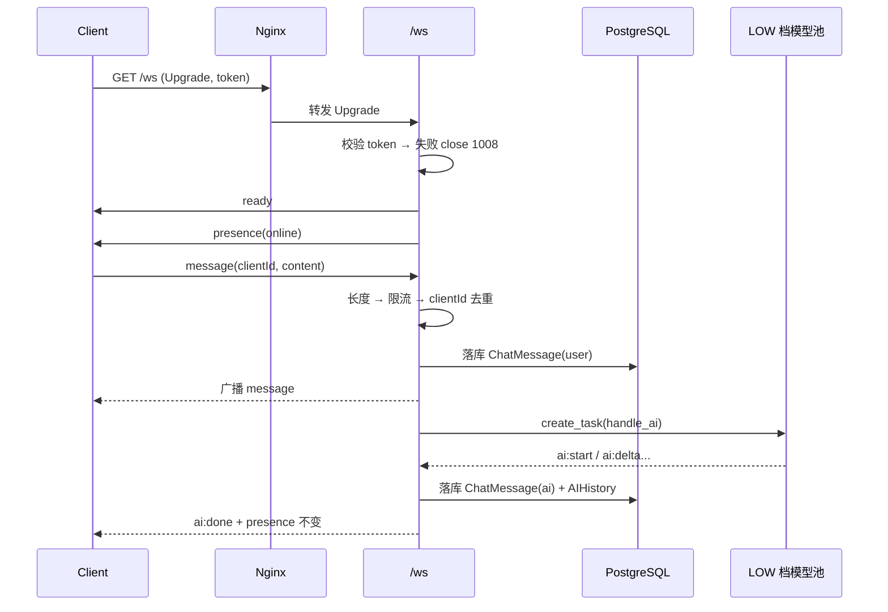

# Feature Specification: Realtime Chat

| 字段 | 值 |
|---|---|
| Spec ID | `004-realtime-chat` |
| Status | implemented |
| Version | 2.0.0 |
| Owner | Realtime Service |
| Scope | `/ws` 连接生命周期、消息协议、治理五件套、@AI 触发与广播 |
| Related | `specs/001-ai-chat-orchestration`、`specs/002-rag-retrieval`、`specs/DEV_SPEC.md` §6.4 §6.6 §11 |
| Evidence | `app/ws/{protocol,room,chat,ai_chat}.py`、`app/models/chat.py`、`app/core/config.py`、`nginx.conf`、`tests/test_ws_ai_mentions.py` |

## 1. 背景

共享聊天室是一个长生命周期对象，它的失败模式与 HTTP 完全不同：

| 现象 | 根因 | 后果 |
|---|---|---|
| 在线人数只增不减 | 浏览器断电/关页面不发 close 帧，TCP 半开 | 连接数泄漏，内存持续上涨 |
| 全员卡顿 | 脚本一分钟刷上千条消息，广播放大 | 正常用户被拖慢 |
| 重复消息与重复 AI 回复 | 用户点两下、网络重传 | 数据重复，AI 成本翻倍 |
| 匿名连接占资源 | 没有任何合法身份即建立连接 | 资源被无成本占用 |

因此握手鉴权、心跳、限流、去重、presence 广播必须一起做，否则上线第一个晚上就会同时踩到上面四个坑。

## 2. 目标

- 未登录连接在握手阶段被拒绝，不进入房间。
- 失活连接由服务端主动回收，且不依赖客户端配合。
- 单连接的消息速率有硬上限。
- 重复消息在服务端被识别并丢弃，不落库、不触发 AI。
- 在线人数变化实时同步给所有连接，作为治理效果的可视化验证。
- AI 回复异步进行，不阻塞用户消息的广播。

## 3. 非目标

- 不实现多房间、私聊 UI（私聊表已建但未开放）。
- 不实现跨节点广播与集群化的连接管理。
- 不实现消息已读回执、编辑、撤回与历史分页游标。
- 不实现消息内容审核。
- 不承诺单机在万级连接下的表现。

## 4. 角色与边界

| 角色 | 可以做 | 不可以做 |
|---|---|---|
| 浏览器客户端 | 建连（Cookie / query token）、发消息、ping | 绕过限流、伪造用户身份 |
| Realtime Service | 连接注册与回收、广播、落库、触发 AI | 修改业务数据（除聊天消息与 AI 历史） |
| AI Chat 模块 | 生成 AI 回复并广播 | 阻塞消息广播路径 |
| Nginx | 转发 Upgrade、保持长连接 | 缓冲流式响应 |

## 5. 功能需求

### 5.1 连接与鉴权

| ID | 优先级 | 需求 | 验证 |
|---|---|---|---|
| R-WS-01 | P0 | 握手时按 query `token` → Cookie 顺序取 token，校验失败以 `1008` 关闭。 | 未登录用例 |
| R-WS-02 | P0 | 连接注册成功后发送 `ready`（含用户 id / name / image）。 | 协议用例 |
| R-WS-03 | P0 | 连接注册、注销时广播 `presence`，载荷为当前在线连接数。 | presence 用例 |
| R-WS-04 | P0 | nginx 层必须转发 `Upgrade` / `Connection` 并放宽读超时。 | 配置检查 |

### 5.2 消息与治理

| ID | 优先级 | 需求 | 验证 |
|---|---|---|---|
| R-WS-05 | P0 | 消息内容长度上限 2000，超限返回 `error`。 | 长度用例 |
| R-WS-06 | P0 | 滑动窗口限流：每连接 60 秒内最多 30 条，超限返回 `error rate_limited`。 | 限流用例 |
| R-WS-07 | P0 | 同一连接内重复 `clientId` 必须丢弃；去重环容量 200，超出淘汰最旧。 | 幂等用例 |
| R-WS-08 | P0 | 心跳每 30 秒扫描一次，`last_seen` 超过 60 秒（2× 间隔）由服务端主动关闭。 | 心跳用例 |
| R-WS-09 | P1 | 客户端 `ping` 收到 `pong`，并刷新该连接的 `last_seen`。 | 协议用例 |
| R-WS-10 | P1 | 非法 JSON 或未知消息类型返回 `error`，不断开连接。 | 容错用例 |

### 5.3 消息持久化与广播

| ID | 优先级 | 需求 | 验证 |
|---|---|---|---|
| R-WS-11 | P0 | 用户消息落库为 `ChatMessage(role=user)`，昵称与头像取自数据库最新值，而非连接建立时快照。 | 落库检查 |
| R-WS-12 | P0 | 消息落库后广播 `message` 给全部在线连接。 | 广播用例 |
| R-WS-13 | P1 | `createdAt` 统一序列化为 ISO 8601 UTC 带 `Z`，与前端 `toISOString()` 一致。 | 格式断言 |

### 5.4 @AI

| ID | 优先级 | 需求 | 验证 |
|---|---|---|---|
| R-WS-14 | P0 | 支持 `@温柔宝`（`gentle`）、`@嘴欠宝`（`snarky`）与 `/ai` 命令形式；`/ai` 默认解析为 `snarky`。 | `tests/test_ws_ai_mentions.py` |
| R-WS-15 | P0 | 同一条消息中同一角色只触发一次。 | `tests/test_ws_ai_mentions.py` |
| R-WS-16 | P0 | AI 生成为异步任务，不阻塞用户消息的广播。 | 时序检查 |
| R-WS-17 | P0 | AI 回复按 `ai:start` → `ai:delta` → `ai:done` 顺序下发，并落库为 `ChatMessage(role=ai)` 与 `AIHistory`。 | 协议用例 |
| R-WS-18 | P1 | AI 生成使用 LOW 档模型池，额度异常时按模型池规则切流。 | 降级用例 |

## 6. 消息协议

```text
客户端 → 服务端
  { "type": "message", "clientId": "<uuid>", "content": "<string>" }
  { "type": "ping" }

服务端 → 客户端
  { "type": "ready",     "user": { "id", "name", "image" } }
  { "type": "message",   "message": { "id","userId","userName","image","role","content","createdAt" } }
  { "type": "ai:start",  "role": "gentle" | "snarky" }
  { "type": "ai:delta",  "delta": "<string>" }
  { "type": "ai:done",   "message": { ... } }
  { "type": "presence",  "online": <int> }
  { "type": "pong" }
  { "type": "error",     "code": "<code>", "reason": "<string>" }
```

角色常量：`ROLE_USER=user`、`ROLE_ASSISTANT=assistant`、`ROLE_SYSTEM=system`；AI 角色 `AI_ROLE_GENTLE=gentle`、`AI_ROLE_SNARKY=snarky`。

## 7. 关键参数

| 参数 | 值 | 来源 |
|---|---|---|
| `HEARTBEAT_INTERVAL_MS` | 30000 | `app/core/config.py` |
| 失活判定 | `2 × HEARTBEAT_INTERVAL_MS` = 60000ms | `ws/chat.py` |
| `MAX_MESSAGE_LENGTH` | 2000 | `app/core/config.py` |
| `RATE_LIMIT_WINDOW_MS` | 60000 | `app/core/config.py` |
| `RATE_LIMIT_MAX` | 30 | `app/core/config.py` |
| `MAX_SEEN_CLIENT_IDS` | 200 | `ws/chat.py` |
| nginx `/ws` 读超时 | 3600s | `nginx.conf` |

## 8. 时序



## 9. 失败行为

| 场景 | 行为 |
|---|---|
| token 缺失 / 无效 | `close 1008`，不注册连接 |
| 消息长度 > 2000 | 回 `error`，不落库、不广播 |
| 超过 60s/30 条 | 回 `error code=rate_limited`，不落库 |
| `clientId` 重复 | 静默丢弃，不落库、不广播、不触发 AI |
| 非法 JSON / 未知 type | 回 `error`，连接保持 |
| AI 生成过程中模型切流 | 由模型池处理，用户只看到最终的 `ai:done` |
| AI 生成失败 | 记录日志，不发送 `ai:done` 的伪造内容 |
| 客户端长时间无 ping 且未活动 | 服务端 60s 后主动关闭并注销 |
| 客户端异常断开 | `WebSocketDisconnect` 捕获后注销并广播 presence |

## 10. 可观测性

- 每条消息处理路径上的判定结果（长度、限流、去重）都有明确分支，便于日志挂点。
- `presence` 广播本身就是连接健康的可视化信号：人数只增不减即说明回收失效。
- 落库的 `ChatMessage` 可核对「广播条数 = 落库条数 − 被拒条数」。
- nginx access log 是第一层排障入口。

## 11. 验收标准

| AC | 内容 | 方式 |
|---|---|---|
| AC1 | `@温柔宝` / `@嘴欠宝` / `/ai` 三种形式的角色解析正确，同角色去重 | `python -m unittest tests.test_ws_ai_mentions -v` |
| AC2 | 未携带合法 token 的连接被 `1008` 关闭 | `scripts/test_ws.py` |
| AC3 | 60 秒内第 31 条消息被拒 | 手工冒烟（脚本连发） |
| AC4 | 同一 `clientId` 重复发送只产生一条落库记录 | 手工冒烟 |
| AC5 | 客户端静默 60 秒后被服务端断开并广播 presence | 手工冒烟 |
| AC6 | AI 回复按 `ai:start → ai:delta → ai:done` 顺序到达并落库 | `scripts/test_ws.py` |

## 12. 需求追踪

| 需求 | 计划 | 任务 | 验证 |
|---|---|---|---|
| R-WS-01 | Plan §3 | T-WS-01 | 未登录用例 |
| R-WS-02 | Plan §3 | T-WS-02 | 协议用例 |
| R-WS-03 | Plan §3 | T-WS-03 | presence 用例 |
| R-WS-04 | Plan §8 | T-WS-13 | 配置检查 |
| R-WS-05 | Plan §4 | T-WS-04 | 长度用例 |
| R-WS-06 | Plan §4 | T-WS-05 | 限流用例 |
| R-WS-07 | Plan §4 | T-WS-06 | 幂等用例 |
| R-WS-08 | Plan §5 | T-WS-07 | 心跳用例 |
| R-WS-11 | Plan §6 | T-WS-08 | 落库检查 |
| R-WS-12 | Plan §6 | T-WS-09 | 广播用例 |
| R-WS-14 | Plan §7 | T-WS-10 | `test_ws_ai_mentions.py` |
| R-WS-15 | Plan §7 | T-WS-11 | `test_ws_ai_mentions.py` |
| R-WS-17 | Plan §7 | T-WS-12 | 协议用例 |
